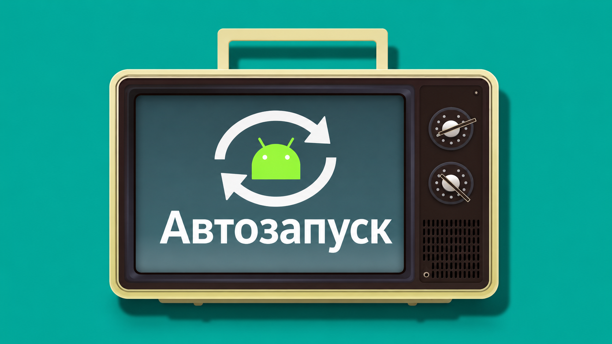
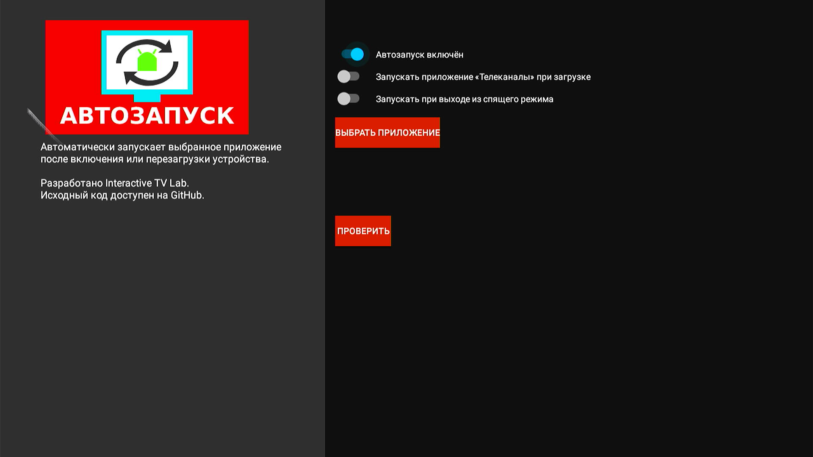
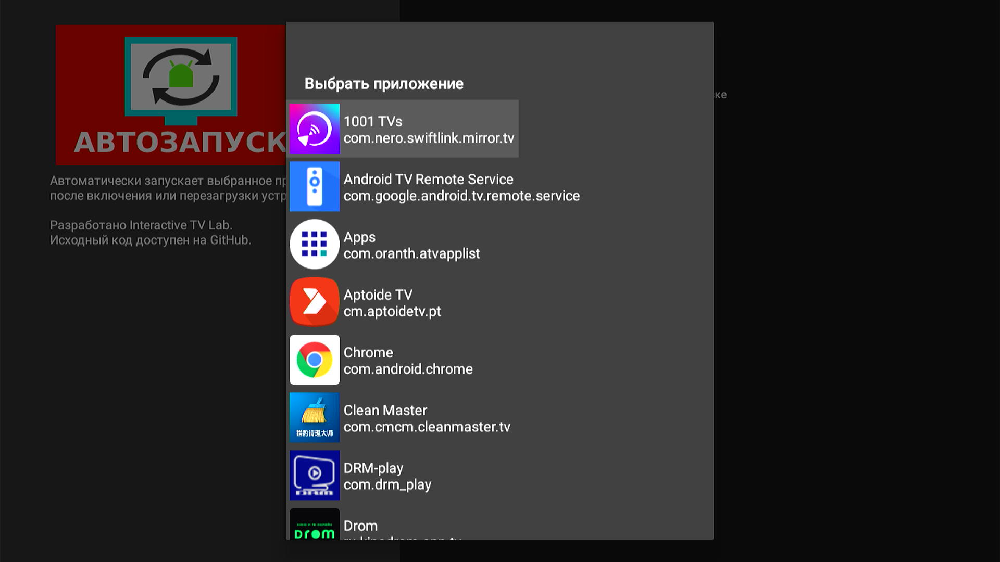

# Launch-On-Boot — Android TV app auto-start (Russian-language fork)

[Русский README](README.md) · [FAQ](FAQ.md) · [Download APK](https://github.com/d-p4d-67/Launch-On-Boot/releases/latest)

**Launch-On-Boot** is a free Android TV utility that can automatically open a selected installed application when the device boots. It is useful for TV boxes, media players, kiosk-style installations, and digital signage setups where you want an app to open after startup instead of manually choosing it from the home screen.

This repository is a **Russian-language fork** of [jeff2900/Launch-On-Boot](https://github.com/jeff2900/Launch-On-Boot), not the original release. The `v1.4.0-ru.2` release adds a Russian translation and removes the onboarding screens. The upstream project originates from [ITVlab/Launch-On-Boot](https://github.com/ITVlab/Launch-On-Boot).

## Features

- Automatically launch a selected app after Android TV boot or restart.
- Optional launch when the device wakes from sleep, subject to device restrictions.
- Select TV/Leanback-compatible apps or display all installed apps.
- Support for launching the Live Channels / TV app.
- Option to mute audio at startup.
- Test the selected app from the interface.
- Russian UI with onboarding removed in this fork.

**Compatibility note:** Automatic background launching is affected by device firmware, Android version, vendor policies, and power management. The app is primarily intended for Android TV; **universal Google TV compatibility is not guaranteed**.

## Download the APK

**[Latest published release on GitHub](https://github.com/d-p4d-67/Launch-On-Boot/releases/latest)**

Published release at the time of this documentation update: **v1.4.0-ru.2**.

[Direct APK download — v1.4.0-ru.2](https://github.com/d-p4d-67/Launch-On-Boot/releases/download/v1.4.0-ru.2/Launch.on.Boot.1.4.0-ru.2.apk)

For this release: `minSdk 21`, `targetSdk 34`. These Android SDK values do not imply that all Android phones, TV boxes, or Google TV devices are supported.

## How to automatically launch an app when Android TV starts

1. Download the APK from [GitHub Releases](https://github.com/d-p4d-67/Launch-On-Boot/releases) and install it on your TV device. Sideloading may require allowing installations from the selected source.
2. Open **Launch-On-Boot**.
3. Enable automatic launch.
4. Select the app you want to launch on boot.
5. Optionally enable launch after wake-up or other settings.
6. Use the test button, then restart your device to verify behavior.

## Screenshots

## APK integrity

SHA-256 for **v1.4.0-ru.2**:

`875898602479b9b537e7dd37588387b415fd6f58e0b23f7a996648fdc163fb81`

[View VirusTotal report](https://www.virustotal.com/gui/file/875898602479b9b537e7dd37588387b415fd6f58e0b23f7a996648fdc163fb81). Check the hash of the downloaded APK; a scan is not an absolute security guarantee.

## FAQ and troubleshooting

See [FAQ.md](FAQ.md) for English and Russian answers, including:
- How to start an app automatically after Android TV reboot
- Starting an app when Android TV wakes up
- Whether the app works on Google TV
- Why auto-start might fail on some devices

## License and credits

This is a fork of [jeff2900/Launch-On-Boot](https://github.com/jeff2900/Launch-On-Boot), based on [ITVlab/Launch-On-Boot](https://github.com/ITVlab/Launch-On-Boot). The repository includes an [MIT license](LICENSE). Credit belongs to the upstream contributors.
