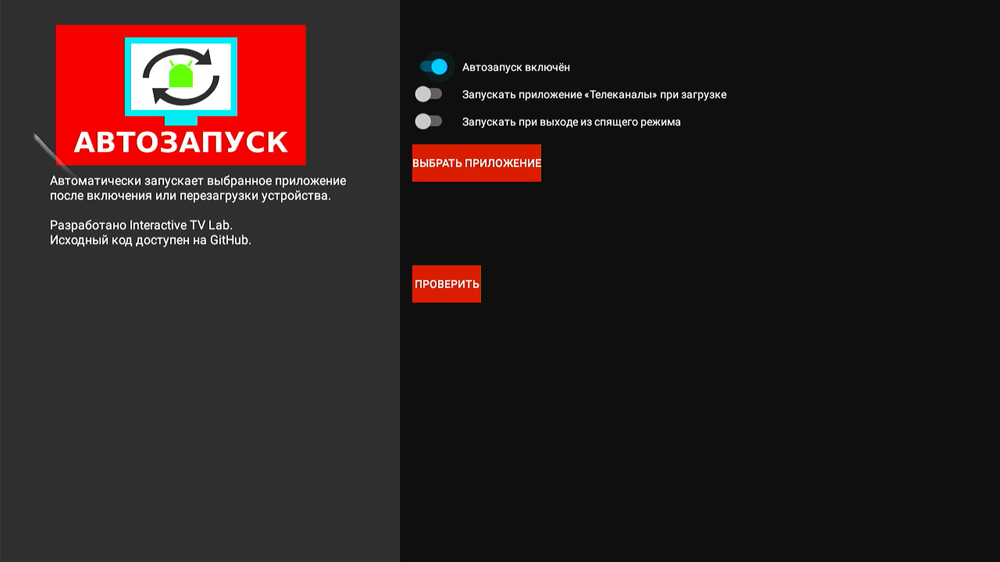
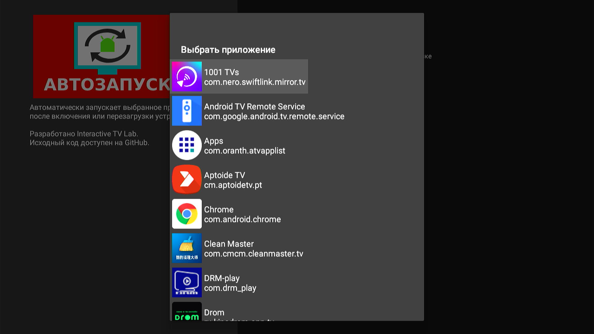

# Launch-On-Boot

## О приложении

**Launch-On-Boot** — небольшая утилита для Android TV, которая автоматически запускает выбранное приложение после включения или перезагрузки устройства.

По умолчанию Android TV после загрузки открывает домашний экран. Это не всегда удобно, особенно если устройство используется как ТВ-приставка, информационный экран, киоск или медиаплеер, где после включения должно сразу запускаться определённое приложение.

Launch-On-Boot позволяет выбрать приложение, которое будет запускаться автоматически после старта устройства. Можно запускать приложения с поддержкой Leanback, приложение для просмотра телеканалов или другое установленное приложение.

## Возможности

- автоматический запуск выбранного приложения после загрузки Android TV;
- запуск приложения при выходе устройства из спящего режима;
- поддержка ТВ-интерфейса Leanback;
- запуск приложения «Телеканалы» / Live Channels;
- возможность отображать все установленные приложения;
- отключение звука устройства при запуске;
- быстрый тест выбранного приложения;
- простой интерфейс без лишних настроек;
- русский интерфейс.

## Как использовать

1. Установите и откройте Launch-On-Boot.
2. Включите функцию автоматического запуска.
3. Нажмите **«Выбрать приложение»**.
4. Выберите приложение, которое должно запускаться автоматически.
5. При необходимости включите запуск при выходе из спящего режима или другие параметры.
6. Нажмите **«Проверить»**, чтобы убедиться, что выбранное приложение запускается корректно.
7. Перезагрузите устройство для проверки автоматического запуска.

## Скриншоты

## Загрузка

Приложение доступно в:

- [Releases](https://github.com/d-p4d-67/Launch-On-Boot/releases)

## Исходный проект

Этот репозиторий является форком проекта **Launch-On-Boot**.

Оригинальный проект:
[jeff2900/Launch-On-Boot](https://github.com/jeff2900/Launch-On-Boot)

## Лицензия

Условия использования и распространения определяются лицензией исходного проекта.
