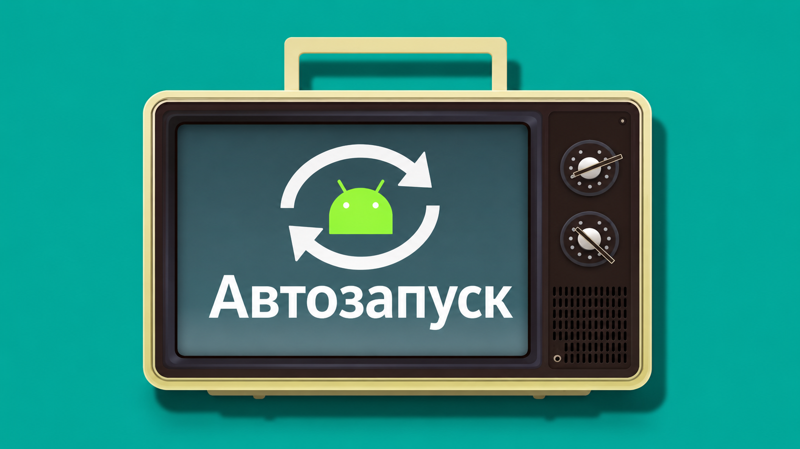
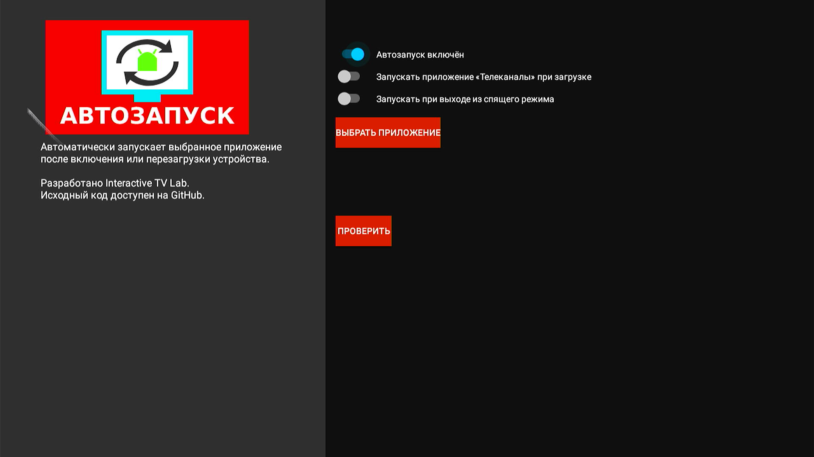
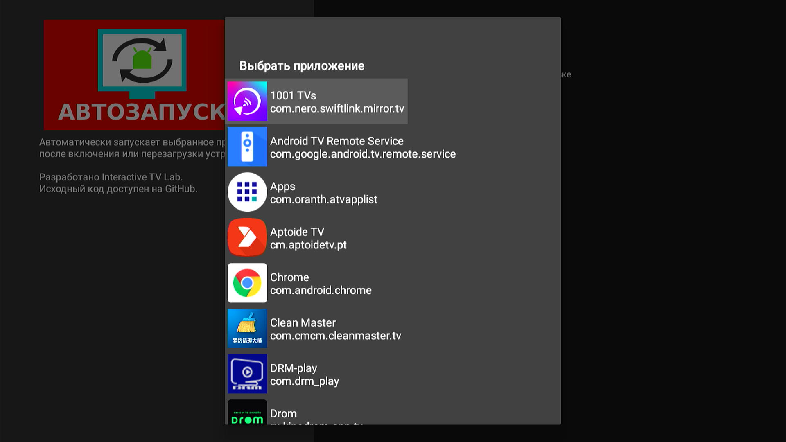

# Launch-On-Boot — автозапуск приложений на Android TV

[Русский](#русский) · [English](README.en.md) · [FAQ / Частые вопросы](FAQ.md) · [Скачать APK](https://github.com/d-p4d-67/Launch-On-Boot/releases/latest)

## Русский

**Launch-On-Boot** — бесплатная утилита для Android TV, которая автоматически запускает выбранное установленное приложение после включения или перезагрузки устройства. Подходит для сценариев с ТВ-приставкой, медиаплеером, информационным экраном или киоском, когда нужно открывать приложение вместо домашнего экрана.

**Это русскоязычный форк**, а не оригинальный проект: в версии `1.4.0-ru.2` добавлен русский перевод и убран экран первоначального знакомства (онбординг). Основные настройки совместимости исходного проекта сохранены.

### Возможности

- Автозапуск выбранного приложения после загрузки Android TV.
- Запуск при выходе устройства из спящего режима (если поддерживается устройством).
- Выбор приложений с TV-интерфейсом Leanback; возможность показать все установленные приложения.
- Запуск приложения «Телеканалы» / Live Channels.
- Отключение звука при запуске.
- Проверка выбранного приложения кнопкой «Проверить».
- Русскоязычный интерфейс без онбординга.

> Поведение автозапуска зависит от версии Android TV, прошивки и ограничений фонового запуска на конкретном устройстве. Не гарантируется работа на любой модели, включая устройства Google TV.

### Скачать и установить

**[Скачать последнюю опубликованную версию APK (GitHub Releases)](https://github.com/d-p4d-67/Launch-On-Boot/releases/latest)**

Текущий опубликованный релиз на момент обновления документации: **v1.4.0-ru.2**.

[Прямая ссылка на APK v1.4.0-ru.2](https://github.com/d-p4d-67/Launch-On-Boot/releases/download/v1.4.0-ru.2/Launch.on.Boot.1.4.0-ru.2.apk)

1. Скачайте APK из раздела Releases и установите его на Android TV. При установке вручную устройство может запросить разрешение на установку из выбранного источника.
2. Откройте Launch-On-Boot.
3. Включите автозапуск и нажмите **«Выбрать приложение»**.
4. Выберите нужное приложение; при необходимости включите запуск при пробуждении и другие параметры.
5. Нажмите **«Проверить»**, затем перезагрузите устройство и проверьте запуск.

Для разработчиков: в релизе указаны `minSdk 21` и `targetSdk 34`. Это параметры сборки, а не гарантия совместимости с любым Android-устройством.

### Скриншоты

### Проверка APK

Для файла релиза `v1.4.0-ru.2`:

- SHA-256: `875898602479b9b537e7dd37588387b415fd6f58e0b23f7a996648fdc163fb81`
- [Отчёт VirusTotal](https://www.virustotal.com/gui/file/875898602479b9b537e7dd37588387b415fd6f58e0b23f7a996648fdc163fb81)

Сверьте контрольную сумму скачанного файла с указанной выше. Отчёт VirusTotal не является гарантией абсолютной безопасности.

### Частые вопросы

**Как автоматически запускать приложение при включении Android TV?** Установите Launch-On-Boot, выберите приложение, включите автозапуск и проверьте результат после перезагрузки.

**Можно ли запускать приложение после выхода телевизора из сна?** В настройках предусмотрена такая возможность, но её работа зависит от устройства.

**Работает ли на Google TV?** Некоторые устройства могут быть совместимы, однако универсальная поддержка Google TV не подтверждена. Проверьте на своей модели.

**Почему приложение не запускается автоматически?** Производители могут ограничивать старт приложений после загрузки или пробуждения; проверьте настройки и ограничения устройства.

Больше ответов на русском и английском — в [FAQ.md](FAQ.md).

### Происхождение и лицензия

Этот репозиторий является форком [jeff2900/Launch-On-Boot](https://github.com/jeff2900/Launch-On-Boot), который, в свою очередь, основан на [ITVlab/Launch-On-Boot](https://github.com/ITVlab/Launch-On-Boot). В проекте присутствует [лицензия MIT](LICENSE). Благодарность авторам исходных версий.

---

**English:** [Read the English documentation](README.en.md) — Android TV auto-start app, launch selected app on device boot or wake, Russian-language fork.
